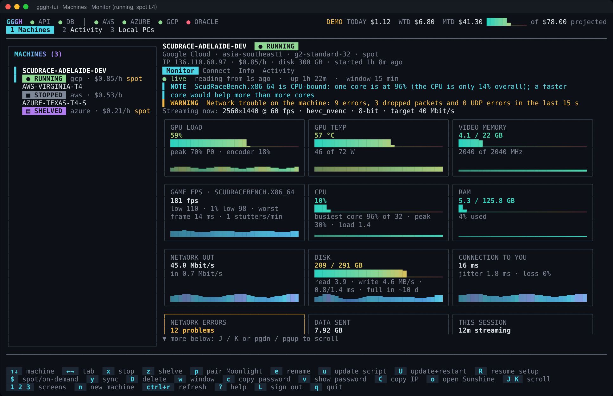
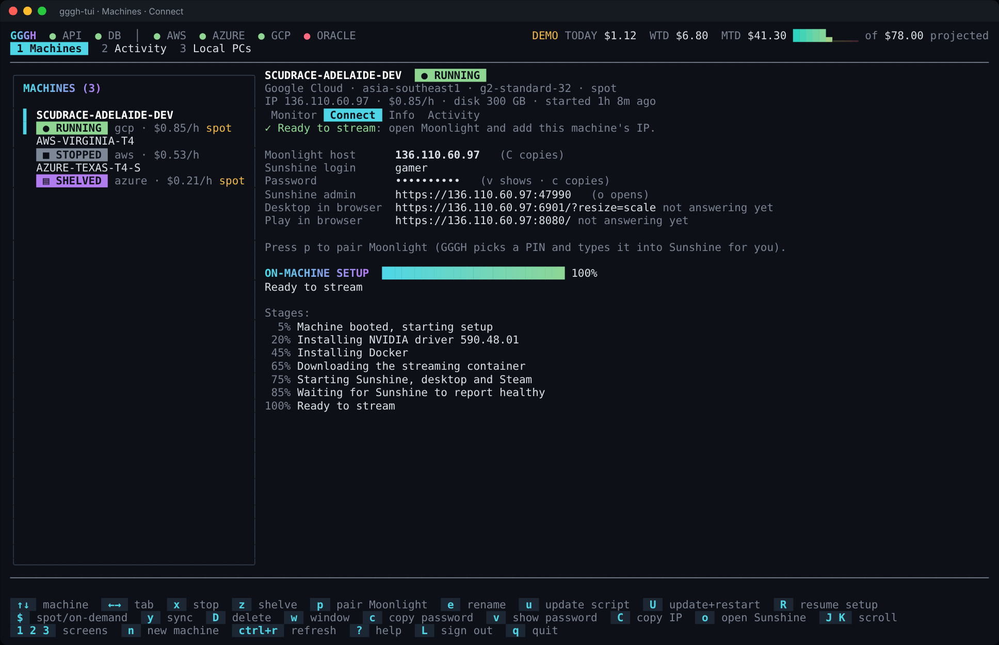
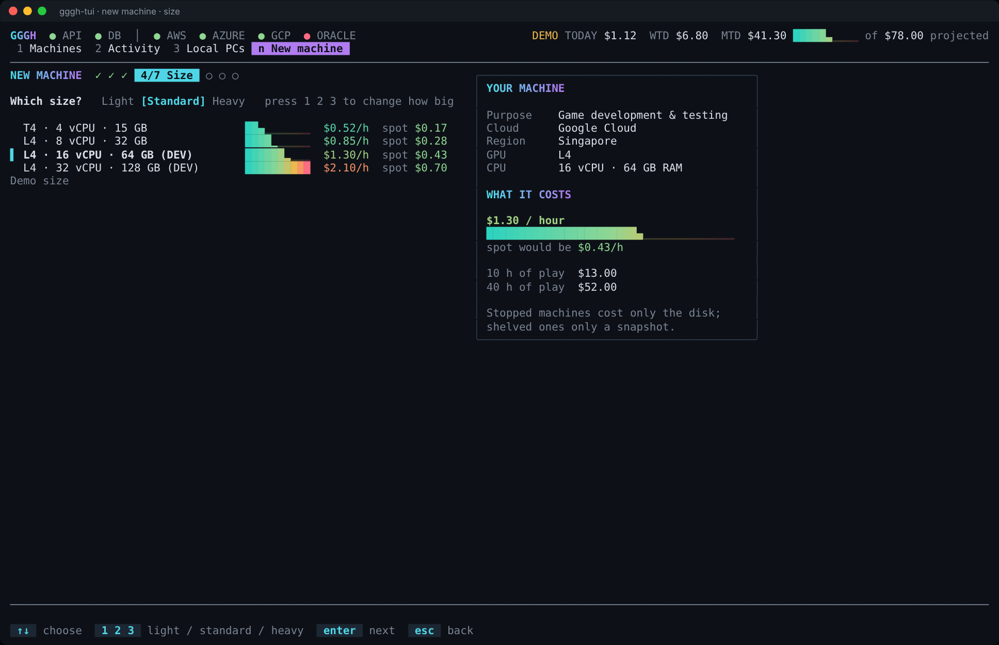
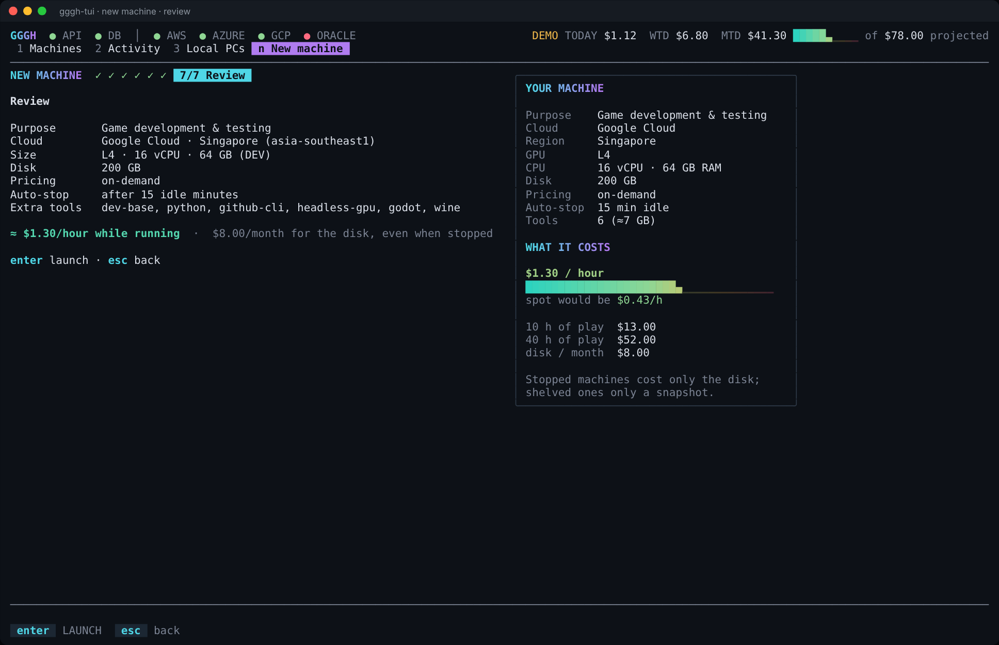
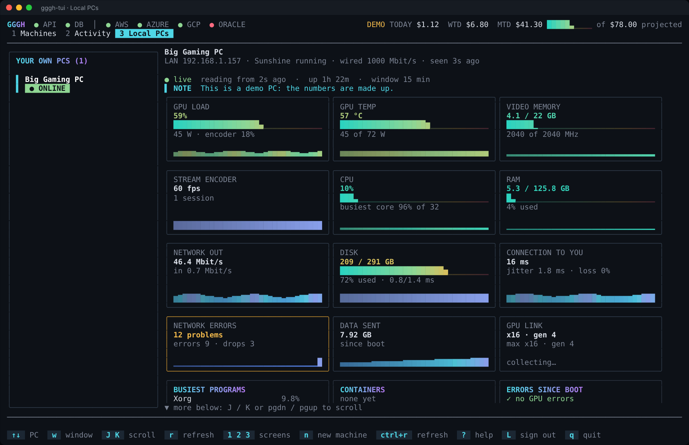

# gggh-tui: GGGH in your terminal

A [Bubble Tea](https://github.com/charmbracelet/bubbletea) terminal app for the GGGH cloud gaming
service. It talks to the same backend as the web app (`/api/...`), so everything you do here shows up
there and the other way round.

```
gggh-tui --demo     # try it with made-up machines: no login, no cost, nothing contacted
gggh-tui            # sign in (email + password, or paste a token), then use your real machines
```

## Screenshots







## Build and run (macOS)

You need Go 1.22 or newer (`brew install go`).

```bash
cd tui
go run . --demo                 # try it
go build -o gggh-tui . && ./gggh-tui

# a binary for the other Mac architecture (from any machine):
GOOS=darwin GOARCH=arm64 go build -o gggh-tui-arm64 .    # Apple silicon
GOOS=darwin GOARCH=amd64 go build -o gggh-tui-amd64 .    # Intel
```

Any modern terminal works (Terminal.app, iTerm2, Ghostty, Kitty, Warp...). 100 columns or wider
gives the two-pane layout; narrower terminals stack it.

## Signing in

- **Email and password:** type them on the first screen. The token the backend returns is saved in
  `~/Library/Application Support/gggh/tui.json` (permissions 600). `L` signs out and deletes it.
- **Google or Apple sign-in:** press `ctrl+t` on the sign-in screen and paste your token. In the web
  app: browser developer tools, Application, Local Storage, copy the value of `cg_token`.
- **From the environment:** `GGGH_TOKEN=... gggh-tui`. A different backend: `--api https://host/api`
  or `GGGH_API`. The default is `https://cloudgaming-production.up.railway.app/api`.

## What you can do

| Screen | What it shows |
|---|---|
| **1 Machines** | Your cloud machines with status, cost per hour and a detail pane: **Monitor** (live telemetry with trend lines: GPU, VRAM, temperature, game FPS and frame pacing, CPU and busiest core, RAM, network, disk, ping to your device, network errors, data sent, session and idle cost, auto-stop countdown, stalls, GPU programs, alerts), **Connect** (IP, Sunshine login, setup progress), **Info**, **Activity** |
| **2 Activity** | Every operation (launch, start, stop, shelve...) and a live step-by-step log |
| **3 Local PCs** | Your own home gaming PCs and their telemetry |
| **n New machine** | The launch wizard: what it is for, cloud, region, size (light / standard / heavy), options, extra tools, review |

Keys (press `?` in the app for the list): `s` start, `x` stop, `z` shelve, `r` restore, `p` pair
Moonlight, `u`/`U` update the on-machine script (and restart), `R` resume setup, `e` rename,
`$` spot or on-demand, `D` delete, `w` monitor window, `c`/`C` copy password / IP, `o` open Sunshine,
`←→` tabs, `↑↓` machines, `ctrl+r` refresh, `q` quit. Anything that costs money or deletes asks first.

## How it works

- `api.go`: the types and the `Backend` interface. `http.go`: the real backend (JSON over HTTPS with
  your token). `demo.go`: an in-memory fake account with machines that really change state.
- `model.go`: the Bubble Tea model (Init / Update / View), polling and keys. `view.go`: the screens.
  `monitor.go`: the telemetry picture. `wizard.go`: the launch wizard. `widgets.go`: sparklines and tiles.
- Polling: machines every 5 s (every 2 s while one is changing state), the open machine's telemetry
  every 5 s, status lights every 20 s, spend every minute. Nothing runs while you are signed out.

## Tests

`go test ./...` drives the whole app against the demo backend (keys in, rendered screens checked).
`SHOW=1 go test -run TestLaunchWizard -v` prints the screens it renders.
